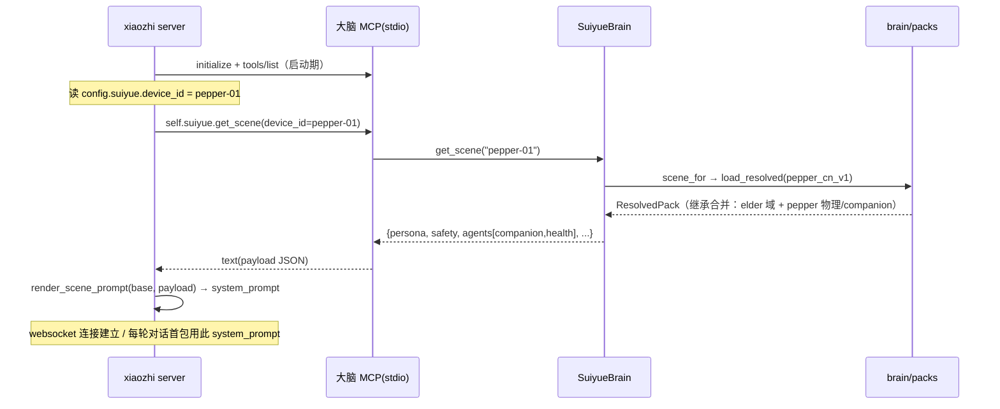

# xiaozhi-esp32-server 薄改动指南：`get_scene` → system prompt

日期：2026-09-22 ｜ 状态：**草稿（待 sign-off）** ｜ 依赖：ADR-012（场景包加载与选择）、MCP-CONTRACT §8
适用范围：fork 的 `xiaozhi-esp32-server`（本仓 overlay，非本仓代码）｜ 对应大脑侧：`suiyue/brain/mcp/`

---

## 1. 目标与边界

**目标**：让 Pepper（及其他本体）的 LLM 会话真正用上 `brain/packs/` 里的场景包（persona / safety / agents），
而不是在 `xiaozhi-esp32-server` 里硬编码 prompt 文案。

**原则（端侧 OS 透明 / 场景热切换）**：
- 场景内容**只存 `brain/packs/`**，xiaozhi server 不硬编码任何 persona / safety 文案；
- 大脑侧零改动（`self.suiyue.get_scene` 已落地，见 `server.py:95-117`、`:230-237`）；
- 本改动是**薄改动**：只动 fork 的 3 处（§3），不引入新服务、不新增传输；
- 复用语ozhi 已有的 MCP client 通道（本仓 `xiaozhi-mcp-settings.example.json` 已把大脑配成它的 MCP server）。

**不做**（避免双驱动 / 越权）：
- 不在 LLM 可见工具里暴露 `self.pepper.*`（G6 暂未建，且会与端侧 `EMOTION_TO_ACTION` 冲突，见 §8）；
- 不把 `emotion_calibration` 写进 prompt（那是端侧 emotion→motion 曲线，见 §9）。

---

## 2. 已就绪的大脑侧接口（复述，避免歧义）

| 项 | 事实 | 位置 |
|---|---|---|
| 传输 | **stdio MCP**（`python -m brain.mcp --config <cfg>`）；xiaozhi 作为 MCP client 拉起 | `__main__.py:26-89` |
| 拉起配置 | `xiaozhi-mcp-settings.example.json` 的 `command`+`args`+`env` | 本仓 `brain/mcp/` |
| 工具 | `self.suiyue.get_scene(device_id, scene?)` | `server.py:95-117` |
| 返回体 | `{scene_pack, device_model, persona, safety{hard_rules,disclaimer,emergency}, agents[{name,system_prompt,tools,trigger_examples}], emotion_calibration}` | `loader.py:57-80`（`to_scene_payload`） |
| 选择 | 显式 scene > device_model 匹配取最高 version > default(`elder_cn_v1`) | `brain.py:67-89`（`scene_for`） |
| Pepper 注册 | `config.yaml` 已含 `pepper-01`(model=pepper_v1, provider=static) | `config.yaml:29-31` |

> `xiaozhi-esp32-server` 不在本仓；下列"改动位置/类名"基于标准 xiaozhi-server 结构，请按你的 fork 实际 import / 类命名适配。

---

## 3. 改动总览（3 处）

| # | 位置（fork 内） | 改什么 | 行数量级 |
|---|---|---|---|
| X1 | `config.yaml`（xiaozhi 自身） | 新增 `suiyue.device_id`（声明"我是哪个本体"） | +2 行 |
| X2 | MCP 初始化处 | 拿到大脑 MCP client session 句柄，存到可访问的上下文 | +数行 |
| X3 | system prompt 构造处 | 会话/连接建立时**主动**调一次 `get_scene`，把结果渲染进 prompt；失败回退写死 prompt | +约 30 行（含 `render_scene_prompt`） |

> 不碰 LLM 的 function-calling 路径：场景 prompt 是**服务端主动注入**，不是让 LLM 自己决定何时调 `get_scene`（更可控、首轮即生效）。

---

## 4. X1 · device_id 配置（决策 D-A）

一个 xiaozhi server 进程 = 一个机器人（协程）。它必须声明"我是谁"，大脑才知道返回哪个场景包。

**推荐**：在 xiaozhi 的 `config.yaml` 新增命名空间隔离的字段，避免与现有 `device_id`（固件侧 MAC/连接 id）冲突：

```yaml
# xiaozhi config.yaml（你的 fork）
suiyue:
  device_id: pepper-01        # 须与大脑 config.yaml 的 devices[].device_id 一致
```

**备选**：用环境变量 `SUIYUE_DEVICE_ID=pepper-01` 注入（适合容器化部署，不改 config 文件）。

> 一致性硬约束：`pepper-01` 必须与 `suiyue/brain/mcp/config.yaml:29` 的 `device_id` 完全一致，否则 `get_scene` 返回"未知设备"错误（server.py:236）。

---

## 5. 时序



**缓存**（决策 D-D）：`get_scene` 结果在 **xiaozhi server 进程级**缓存（场景不常变）。大脑侧已按 key 缓存（`brain.py:27`）；xiaozhi 侧再缓存一次即可，无需每次连接重拉。场景热更新靠重启 xiaozhi 进程或清缓存（v1 不做热 reload）。

---

## 6. X2 / X3 · 薄改动示意（按 fork 适配）

```python
# ===== X2：MCP 初始化处（示意，按 fork 的 MCP client API 适配）=====
# 标准 xiaozhi-server 的 MCP 由框架拉起，提供 manager.call_tool(server, name, args)
from core.mcp_manager import mcp_manager   # 你的 fork 实际 import 路径
BRAIN_MCP = "SuiyueBrain"                   # 与 xiaozhi-mcp-settings.example.json 的 key 一致

# ===== X3：system prompt 构造处（示意）=====
import json, logging
log = logging.getLogger("xiaozhi.suiyue")

async def build_system_prompt(config: dict, base_prompt: str) -> str:
    did = (config.get("suiyue") or {}).get("device_id")
    if not did or not mcp_manager.has_server(BRAIN_MCP):
        return base_prompt                       # 未配置 → 用写死 fallback（D-C）
    try:
        res = await mcp_manager.call_tool(
            BRAIN_MCP, "self.suiyue.get_scene", {"device_id": did}
        )
        payload = json.loads(res["content"][0]["text"])
        return render_scene_prompt(base_prompt, payload)
    except Exception as e:                        # 大脑没起 / device 未注册 / 解析失败
        log.warning("get_scene 失败(%s)，回退写死 prompt：%s", did, e)
        return base_prompt                        # 失败降级，不阻塞对话（D-C）
```

> 关键点：
> - `get_scene` 是**服务端主动调用**，不经过 LLM function-calling；
> - 异常必须兜底回 `base_prompt`（原写死 prompt），保证大脑挂了对话仍能继续；
> - `base_prompt` 建议保留为"通用兜底人格"，场景包在其上"叠加"而非"替换"。

---

## 7. prompt 组装模板 + 字段映射

`render_scene_prompt(base, scene)` 把 `get_scene` 返回渲染成自然语言段，**叠加**到 `base` 之后：

```python
def render_scene_prompt(base: str, scene: dict) -> str:
    p = scene.get("persona", {})            # 返回体 persona 字段（loader 把包根文件去 manifest 后整体作为此字段）
    pp = p.get("persona", {}) or {}         # 包根文件的 persona: 段（name/tone/address/repetition_policy 在此层）
    tu = p.get("target_user", {}) or {}     # target_user 是 p 顶层键（与 persona 子键同级）
    blocks = [base, "\n# 当前场景包：" + scene.get("scene_pack", "")]

    # —— 角色与语气（来自包根文件的 persona: 段，即 pp）——
    blocks.append(f"你是{pp.get('name','岁悦')}，用{pp.get('address','您')}称呼对方。")
    blocks.append(f"语气：{pp.get('tone','')}；重复应对：{pp.get('repetition_policy','')}。")

    # —— 服务对象 ——
    if tu:
        blocks.append(f"服务对象：{tu.get('profile','')}；语言：{tu.get('language','')}。")

    # —— 开场/平板问候（可选）——
    cui = p.get("companion_ui") or {}
    if cui.get("tablet_greeting"):
        blocks.append(f"开场白示例：{cui['tablet_greeting']}")

    # —— 各 Agent 职责 ——
    for ag in scene.get("agents", []):
        blocks.append(f"\n## 角色：{ag['name']}\n{ag.get('system_prompt','')}")
        if ag.get("trigger_examples"):
            blocks.append("启用时机：" + "；".join(ag["trigger_examples"]))

    # —— 安全护栏（硬规则 + 免责 + 紧急）——
    sf = scene.get("safety", {})
    for rule in sf.get("hard_rules", []):
        blocks.append(f"[硬规则] {rule}")
    if sf.get("disclaimer"):
        blocks.append(f"[免责] {sf['disclaimer']}")
    if sf.get("emergency"):
        blocks.append(f"[紧急] {sf['emergency']}")

    # —— 记忆纪律 + 提醒风格 ——
    mem = p.get("memory") or {}
    if mem.get("confirm_before_save"):
        blocks.append(f"落库前须反问确认：{', '.join(mem['confirm_before_save'])}")
    if p.get("reminders", {}).get("default_style"):
        blocks.append(f"提醒风格：{p['reminders']['default_style']}")

    return "\n".join(blocks)
```

**字段映射表（哪些进 prompt，哪些不进）**：

| 返回字段 | 进 prompt？ | 用途段 | 备注 |
|---|---|---|---|
| `persona.persona.name` / `address` / `tone` / `repetition_policy` | ✅ | 角色与语气 | 实际路径 `scene.persona.persona.*`（persona 字段内再嵌一层，见 §2 返回体） |
| `persona.target_user.{profile,language}` | ✅ | 服务对象 | 注意在 persona 顶层（loader 已展开） |
| `persona.companion_ui.tablet_greeting` | ✅（可选） | 开场白 | 端侧也可直接渲染平板 |
| `agents[].system_prompt` | ✅ | 角色职责 | 每个 agent 一段 |
| `agents[].trigger_examples` | ✅ | 启用时机 | |
| `safety.hard_rules` | ✅ | 硬规则 | 逐条 |
| `safety.disclaimer` / `emergency` | ✅ | 免责 / 紧急 | |
| `persona.memory.confirm_before_save` | ✅ | 记忆纪律 | |
| `persona.reminders.default_style` | ✅ | 提醒风格 | |
| `emotion_calibration` | ❌ | — | **端侧 emotion→motion 用，见 §9** |
| `agents[].tools` 未注册云端者（`self.pepper.*`） | ❌ | — | **大脑侧已过滤**：未注册工具被隔离到 `tools_pending`，见 §8 |
| `device_model` | ⚠️ | 调试 | 可进注释，不进正式 prompt |

---

## 8. 工具暴露边界（决策 D-E，2026-10-06 已结构性落实）

`companion.yaml` / `health.yaml` 曾在`tools:` 里声明 8 个大脑未注册的工具
（`self.pepper.approach/tablet_render/stop_all`、`profile.get/confirm`、`knowledge.rag_search`），
但**大脑 MCP 没有注册它们**（G6 与记忆/知识库均未建）。

**处置：过滤下沉到大脑侧**（不再依赖消费方自律）：

- 场景包 YAML 用两个字段区分意图：
  - `tools:`          —— 大脑**已注册**、可安全暴露给 LLM；
  - `planned_tools:`  —— 路线图意图，**永不下发**。
- `ResolvedPack.to_scene_payload(available_tools=...)` 按注册表把工具切成两桶：
  `tools`（可暴露）与 `tools_pending`（未注册，仅诊断）。
- `SuiyueMCPServer._get_scene` **自动**把本进程 `list_tools()` 的结果传进去，
  所以消费方拿到的 `agents[].tools` **天然是注册表的子集**。
- 返回体新增 `tool_visibility`（`filtered/registered_count/exposed_count/pending_count/registered_tools`），
  供预检与排障。

**为什么不做G6（`self.pepper.*` 云端工具面）**：Pepper 的真实动作由**端侧
`EMOTION_TO_ACTION`** 执行（gateway_config.py 映射），云端再建一套会形成双驱动、
两个权威互相打架。维持"云端只发 emotion，端侧决定动作"的单权威。

> 若未来确需建 G6，先决策"谁为动作权威"，再把工具从 `planned_tools` 移回 `tools`——
> 移回后`precheck_brain_mcp.py` 会自动校验它是否真被注册，不会漏。

---

## 9. `emotion_calibration` 处理（不进 prompt）

`pepper_cn_v1` 的 `emotion_calibration` 形如 `happy:{gain,max,motion:approach_and_wave}`，
其中 `motion` 是**端侧动作名**、`gain/max` 是强度曲线——**全部给端侧 emotion→motion 编排器用**，与 LLM 文本无关。

**规则**：`render_scene_prompt` **不读取 `emotion_calibration`**。把它写进 prompt 会让 LLM 误以为要"描述/执行动作"，
破坏"云只下发 emotion，动作本地执行"的分工。

> 端侧消费路径：xiaozhi 下发 `emotion` 标签（G3 字段契约待定）→ pepper 主网关 `gateway.py` 读 `EMOTION_TO_ACTION` →
> 经 `naoqi_bridge` 下发 `ALMotion`/`ALAnimationPlayer`。这与本文件的 prompt 组装正交。

---

## 10. 失败降级 + 缓存（决策 D-C / D-D）

- **D-C 失败降级**：`get_scene` 异常（大脑未起 / `device_id` 未注册 / JSON 解析失败）→ 用 `base_prompt`（写死兜底）。**绝不阻塞对话**。
- **D-D 缓存**：server 进程级缓存 `get_scene` 结果；场景热更新靠重启 xiaozhi 进程（v1 不做运行时 reload）。

---

## 11. 验收（server 侧怎么测，不依赖真机）

1. **纯接口验证（已在本仓完成）**：`brain.mcp` 起 stdio，模拟 MCP client 发 `tools/call` 调 `self.suiyue.get_scene(device_id=pepper-01)`，
   断言返回 `scene_pack=pepper_cn_v1` 且 `agents` 含 `companion`+`health`（见 `test_loader.py` 与 demo）。
2. **fork 侧冒烟**：把 `xiaozhi-mcp-settings.example.json` 配进你的 fork，启动 xiaozhi，确认进程拉起大脑 MCP 且无 JSON-RPC 错误；
   在 `build_system_prompt` 打 log，确认 `scene_pack` 被正确渲染进 `system_prompt`。
3. **降级验证**：临时把 `device_id` 改成 `nope-99`，确认 xiaozhi 用 `base_prompt` 继续对话（不崩）。
4. **一致性验证**：`config.yaml` 的 `pepper-01` 与 xiaozhi `suiyue.device_id` 一致 → 返回非空；不一致 → 走降级（验收 3）。

---

## 12. 待 sign-off 决策（推荐默认）

| # | 决策点 | 推荐 | 备选 |
|---|---|---|---|
| D-A | device_id 来源 | xiaozhi `config.yaml` 新增 `suiyue.device_id`（命名空间隔离） | 环境变量 `SUIYUE_DEVICE_ID` |
| D-B | prompt 组装位置 | server 主动调 `get_scene` 后本地渲染（首轮即生效，不经 LLM function-call） | 让 LLM 首轮前调 `get_scene` |
| D-C | 失败降级 | 回退写死 `base_prompt`，不阻塞对话 | 失败即拒答 |
| D-D | 缓存 | server 进程级缓存，重启生效 | 每次连接重拉 |
| D-E | 工具暴露 | 只暴露大脑已注册工具（`self.suiyue.*`/`self.daliang.*`），`self.pepper.*` 暂不暴露 | 把包里 `self.pepper.*` 全暴露（需先建 G6） |

---

## 13. 与 Pepper 端侧的一致性（联调时定）

- **G3（emotion 字段契约）**：本改动不依赖 emotion 字段名（prompt 组装不读 emotion_calibration）；但端侧 `gateway.py` 读 `msg.emotion` 的字段名需与 xiaozhi server 实际下发一致（联调时回填）。
- **G4（server 设备绑定）**：xiaozhi 作为大脑 MCP client 的连接，大脑侧靠 `device_id` 参数识别（非连接身份），故 X1 的 `suiyue.device_id` 是绑定锚点，须与大脑 `config.yaml` 一致。

---

> 旁注：本文件是 **overlay 指南**（改 fork 的 3 处），不是本仓代码。本仓内 `xiaozhi-mcp-settings.example.json` 已提供大脑 MCP 的拉起配置；`self.suiyue.get_scene` 契约见 `MCP-CONTRACT.md` §8。
